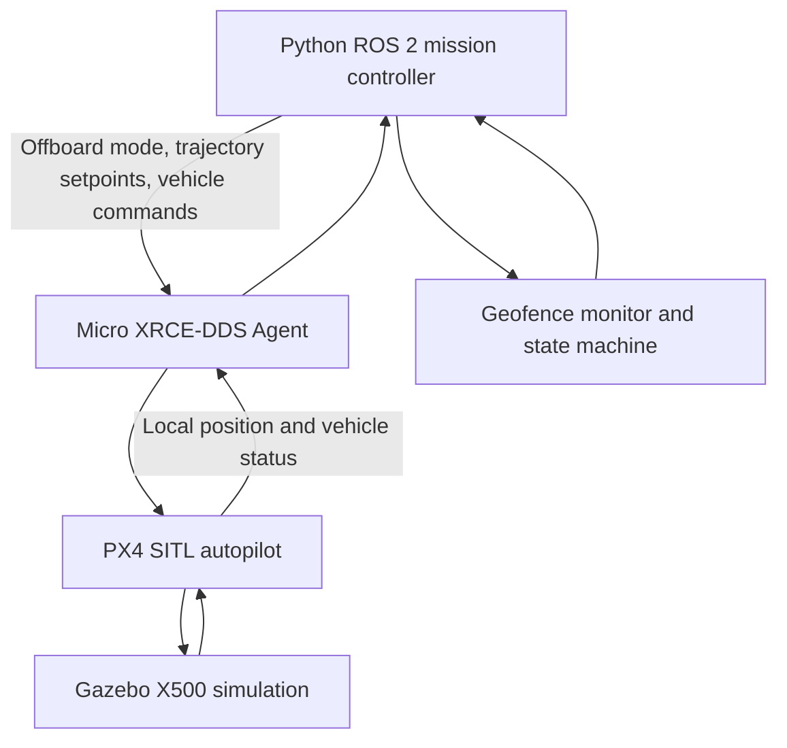

# Architecture

## Division of responsibility

- **ROS 2 controller:** mission state machine, target trajectory, boundary monitoring, landing requests.
- **Micro XRCE-DDS:** bridges PX4 uORB topics and ROS 2 DDS topics.
- **PX4:** flight-mode management, state estimation, low-level control, arming checks.
- **Gazebo:** simulated sensors, vehicle motion, and physics.

## PX4 NED coordinates

North = +X, East = +Y, Down = +Z. A target 5 m above home has Z = `home_z - 5`.

## Interfaces observed in this environment

- Inputs to PX4: `/fmu/in/offboard_control_mode`, `/fmu/in/trajectory_setpoint`, `/fmu/in/vehicle_command`.
- Outputs from PX4: `/fmu/out/vehicle_local_position_v1`, `/fmu/out/vehicle_status_v4`.

Message topic versions are tied to the PX4 build; confirm them when reproducing.
